<div align="center">

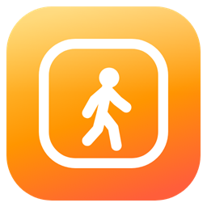

# BeyondCab

**Raus aus der Kabine.**<br>
Aussteigen, um den Truck gehen, von Hand kuppeln, Papiere unterschreiben, tanken, Pannen beheben und Pause machen – zu Fuß und aus der Ich-Sicht in **Euro Truck Simulator 2** und **American Truck Simulator**.

[](../../releases/latest)


### [⬇&nbsp; BeyondCab herunterladen](../../releases/latest)

[English](README.md) · Deutsch

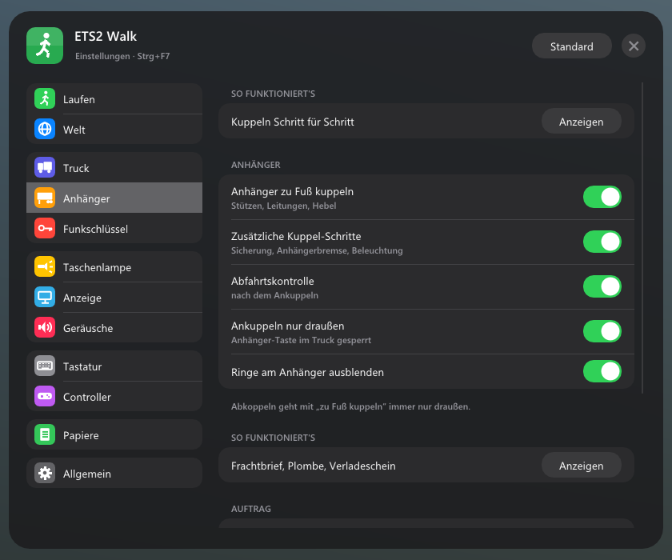

</div>

## Was dich erwartet

🚶 **Zu Fuß unterwegs** – Aussteigen, wenn die Feststellbremse gezogen ist, gehen, rennen, springen, ducken. Der Boden kommt aus der Physik des Spiels, Schritte klingen je nach Untergrund, der Verkehr bremst vor dir, Tore gehen auf, wenn du davorstehst.

🔗 **Auflieger von Hand kuppeln** – Leitungen lösen, Keile anlegen, Stützen kurbeln (oder hydraulisch fahren), Königszapfen ziehen – und alles wieder zurück. Mit Checkliste, Schlepptest und Abfahrtskontrolle rund um den Zug.

📄 **Papiere wie in echt** – In ETS2 der CMR-Frachtbrief vom Lager-Mitarbeiter, in ATS die Bill of Lading. Selbst unterschreiben und stempeln, am Ziel quittiert zurück. Dazu Plombe, Wiegeschein, Gefahrgut-Papiere, Mautbelege, Fähr- und Bahntickets, Fahrerkarte bzw. ELD und Polizei- bzw. DOT-Kontrollen.

🪪 **Führerschein und Bußgeld** – Dein Führerschein (ETS2) bzw. deine CDL (ATS) mit Klassen, ADR und Code 95 bzw. Endorsements und Medical Card – mit deinem Profilbild aus dem Spiel. Polizei, Blitzer und Verlader prüfen ihn, Bußgeldbescheide bzw. Strafzettel kommen in die Papiermappe. Und anschnallen: Ohne Gurt warnt der Gong.

⛽ **Tanken mit Karte** – Tankdeckel auf, Karte ins Terminal, PIN, an der Säule zählen Betrag und Liter (in ATS Gallonen und Dollar) mit, danach gibt es einen Beleg.

📦 **Road Trip (ATS)** – Bei Kurieraufträgen holst du die Sendung beim Absender ab, legst sie auf den Beifahrersitz und übergibst sie am Ziel dem Empfänger – mit Lieferschein.

🚌 **Reisebusse (Coach-DLC)** – Aus- und Einsteigen an der Einstiegstür, Türen per Taste, durch den Gang laufen, über die Stufen hinaus – im Volvo-Doppeldecker auch die Treppe hoch aufs Oberdeck. Ein Fahrtenblatt hält fest, wie pünktlich du an jedem Halt warst.

🔧 **Pannen** – Kleine Schäden mit dem Pannenkit aus dem Staukasten selbst notdürftig flicken, oder den Pannendienst rufen: Ein Abschleppwagen mit Rundumleuchten und Warnblinker fährt vor, der Mechaniker kniet am Rad, repariert den Truck und bringt dir die Rechnung.

🔦 **Und noch mehr** – Funkschlüssel mit Fenstern und Truck-Finder, Taschenlampe, Warnleuchten, Unterlegkeile und Arbeitsleuchte aus dem Staukasten, Bänke zum Pause machen, Schlafen in der Kabine, Anschnallen, jeder Klang einzeln einstellbar, Controller-Unterstützung.

## In 3 Schritten startklar

1. **[Herunterladen](../../releases/latest)** und `BeyondCab-Setup-….exe` starten – das Setup findet ETS2 und ATS selbst und installiert in beide.
2. **Spiel starten** und einmal bestätigen, dass es SDK-Plugins laden darf.
3. **Anhalten, Feststellbremse ziehen, E drücken** – du stehst neben dem Truck. Das Menü öffnest du mit Strg + F7.

Am Spiel selbst wird nichts verändert: keine Mods in den Spieldateien, keine Änderung an der `config.cfg`.

## Bilder

| | |
|---|---|
| 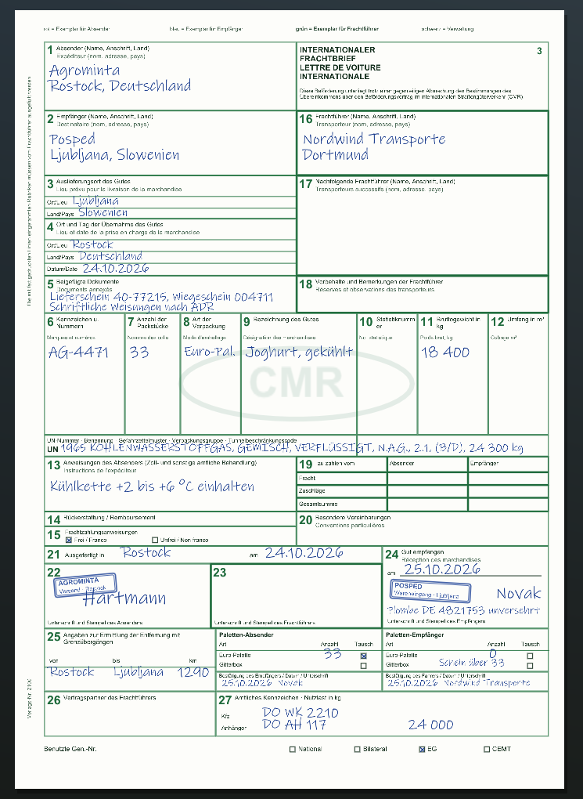 | 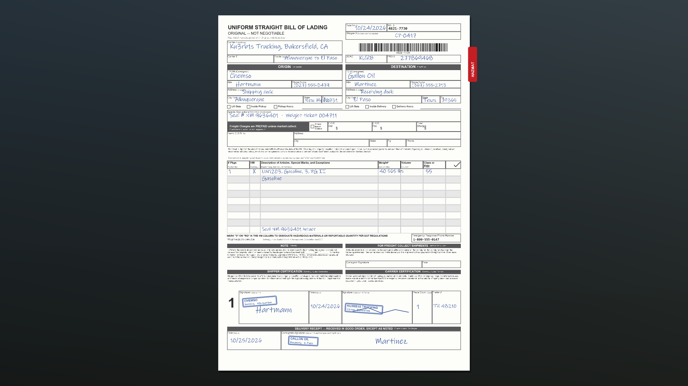 |
| CMR-Frachtbrief (ETS2), quittiert | Bill of Lading mit HAZMAT (ATS) |
| 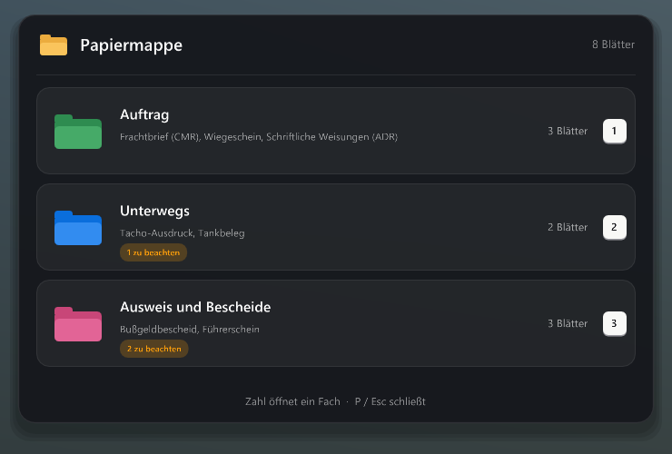 | 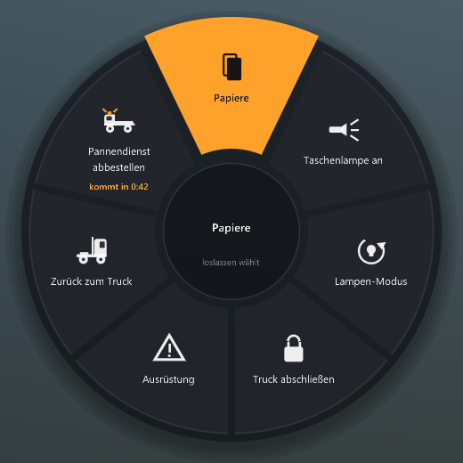 |
| Papiermappe (P) mit Fächern | Schnellwahl-Rad (Tab halten) |
| 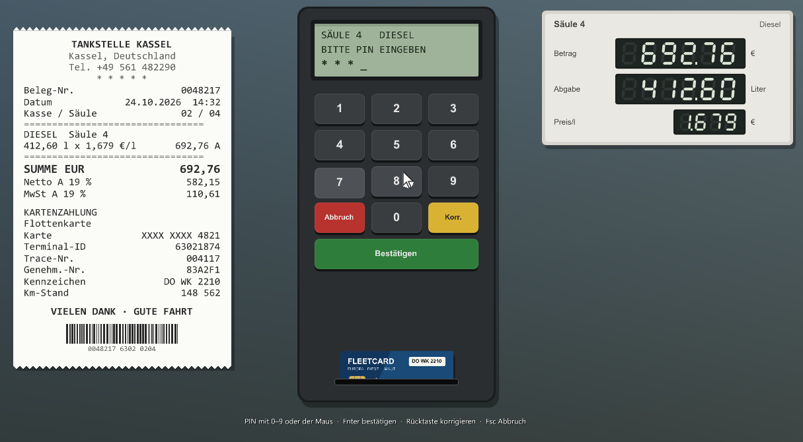 | 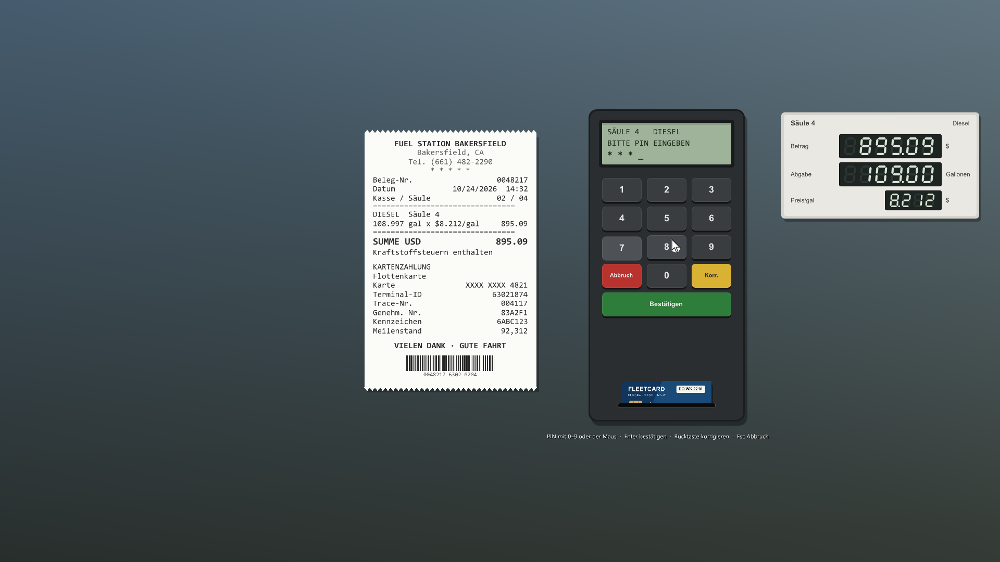 |
| Tankbeleg, Kartenterminal und Zapfsäule | Dasselbe in ATS: Gallonen und Dollar |
| 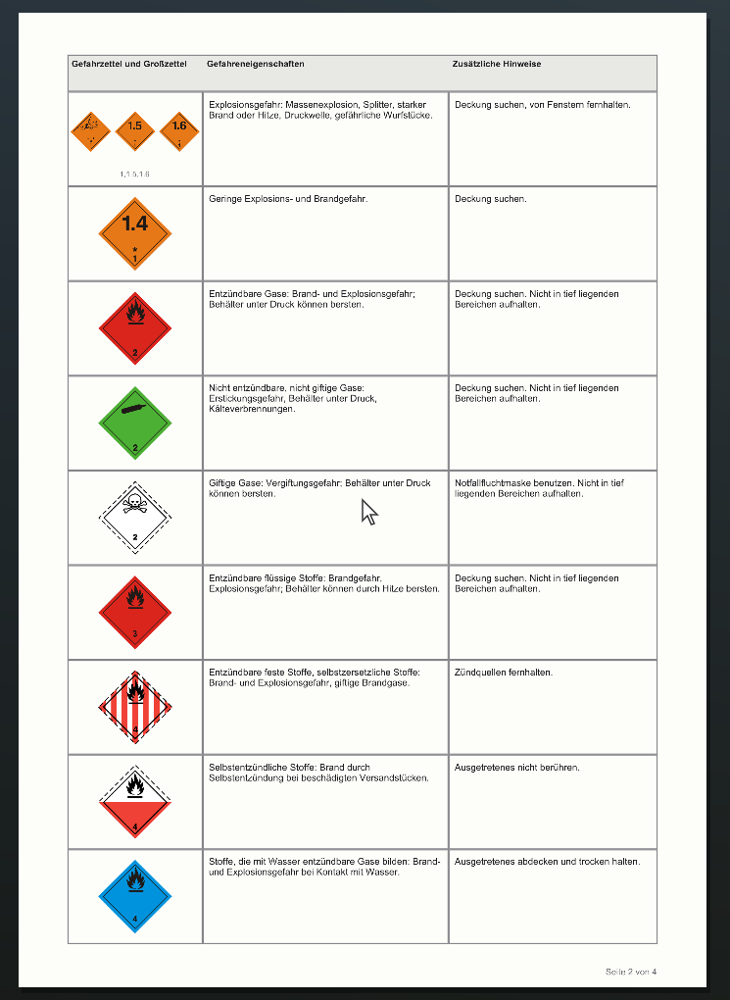 | 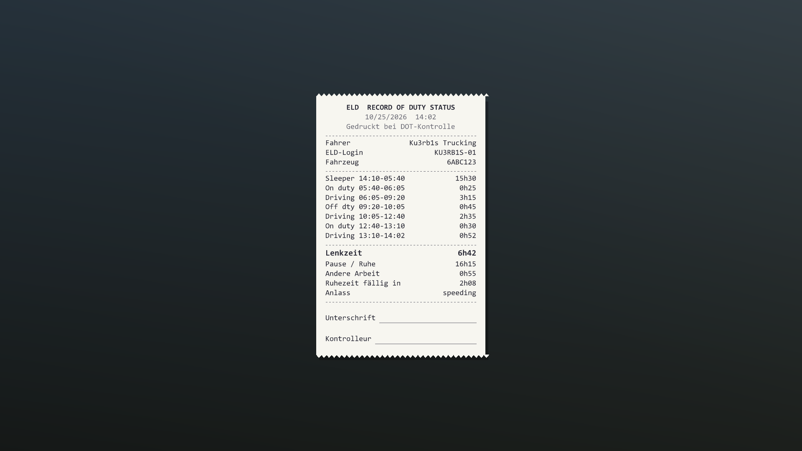 |
| Schriftliche Weisungen nach ADR | ELD-Protokoll (ATS) |
| 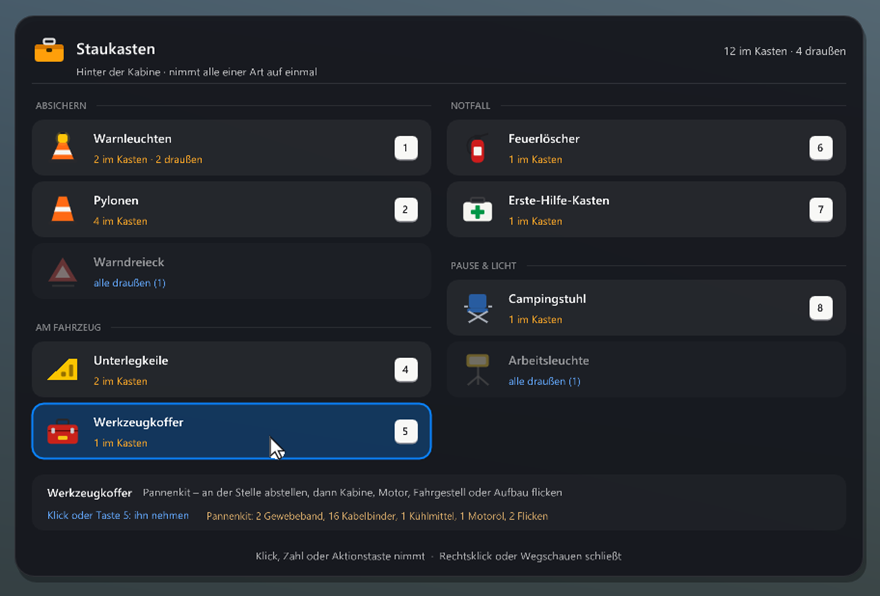 | 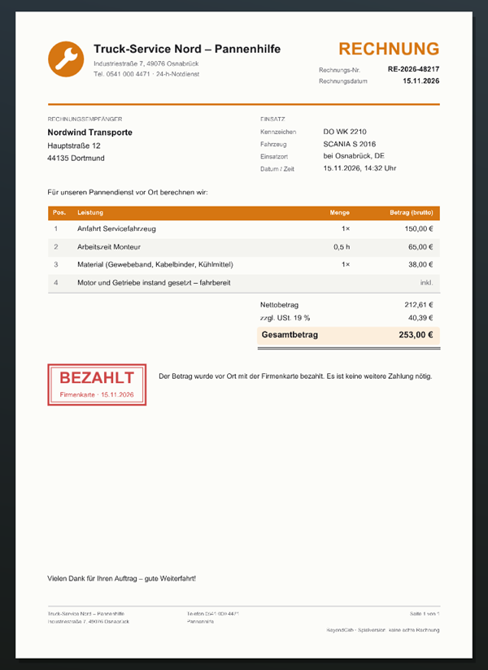 |
| Staukasten mit Werkzeugkoffer (Pannenkit) | Rechnung vom Pannendienst in der Mappe |

## Voraussetzungen

- Windows 10 oder 11 (64 Bit)
- Euro Truck Simulator 2 und/oder American Truck Simulator **1.62** über Steam, Einzelspieler – 1.61 wird weiter unterstützt
- **Entwicklerkamera an**: Aussteigen nutzt die Entwicklerkamera des Spiels. Bei geschlossenem Spiel in `Dokumente\<Spiel>\config.cfg` diese zwei Zeilen auf `"1"` setzen: `uset g_developer "1"` und `uset g_console "1"`. Sind sie aus, sagt BeyondCab es nach dem Start
- Auf Laptops braucht F7 eventuell die **Fn**-Taste (Strg + Fn + F7) – die Menütaste lässt sich im Menü oder in der `beyondcab.ini` (`menu_key_ctrl`) ändern
- Nach einem Spiel-Update kann es sein, dass einzelne Funktionen ausfallen, bis eine neue Version erscheint. Das Plugin prüft beim Start, ob die Stellen im Spiel noch passen, und schaltet sonst nur den betroffenen Teil ab. Nach einem Spiel-Update sagt es einmal, wie es aussieht; der Prüfbericht (`BeyondCab\pruefbericht.txt`, Menü › Spielversion › Öffnen) listet jede geprüfte Stelle – hilfreich für Fehlermeldungen

---

## Alles im Detail

<details>
<summary><b>Laufen</b></summary>

- Aussteigen mit der Aktionstaste, wenn die Feststellbremse gezogen ist. Die Tür geht auf, du stehst neben dem Truck – auch auf der Beifahrerseite
- Gehen, Rennen, Springen, Ducken. Bergauf langsamer, leichtes Kopfwippen, Körpergröße einstellbar
- Der Boden kommt aus der Physik des Spiels: Gehwege, Rampen, Treppen, Laderampen. Leitplanken, Zäune und Fahrzeuge halten dich auf
- Schritte klingen je nach Untergrund (Asphalt, Kies, Gras, Metall, Schnee, Holz), bei Regen und auf nassem Boden nass
- Der KI-Verkehr bremst vor dir und hupt, wenn du zu lange auf der Straße stehst
- Tore und Schranken an Firmengeländen gehen auf, wenn du davorstehst (ETS2)
- Pfeile oben im Bild zeigen auf Wunsch, wo Truck, Auflieger und Lager-Mitarbeiter stehen

</details>

<details>
<summary><b>Im Truck</b></summary>

- Auf den Beifahrersitz wechseln oder dich in einer Schlafkabine aufs Bett legen. Ob dein Truck ein Bett hat, erkennt das Plugin selbst
- Auf dem Bett: Taste halten zum Schlafen (über den Schlaf-Dialog des Spiels)
- Am Beifahrersitz und auf dem Bett klingt es wie in der Kabine, nicht wie draußen
- Lenkzeit (optional): In ETS2 steckst du zu Schichtbeginn die Fahrerkarte in den Fahrtenschreiber, in ATS meldest du dich am ELD an. Oben rechts siehst du Lenk- und Ruhezeit, am Gerät druckst du den Tagesausdruck bzw. das ELD-Protokoll – mit Wochenwert. In der Papiermappe liegt die Wochenübersicht: je Tag ein 24-Stunden-Streifen mit Lenken, Arbeit, Pause und Ruhe, dazu die Summen und was zu lang oder zu kurz war. Alles bleibt je Profil gespeichert

</details>

<details>
<summary><b>Auflieger von Hand kuppeln</b></summary>

- Abkoppeln: Luft- und Stromleitungen lösen, Unterlegkeile anlegen, Stützen runterkurbeln, Königszapfen-Hebel ziehen
- Ankoppeln: unterfahren, Sattelkupplung prüfen, Leitungen anschließen, Stützen hochkurbeln, Keile entfernen. Danach Schlepptest
- Hydraulische Stützen (zum Beispiel am Autotransporter) fährst du per Knopf statt zu kurbeln – mit eigenen Schritten und Geräuschen
- Optional mehr Schritte: Sicherung am Kupplungshebel, Anhänger-Feststellbremse (roter Knopf), Beleuchtung prüfen
- Eine Checkliste zeigt, was als Nächstes dran ist. Hängt einmal etwas fest, setzt „Kuppeln hängt fest?“ im Menü den Ablauf zurück
- Nach dem Ankuppeln einmal um Truck und Auflieger gehen: Reifen, Licht, Ladung und Türen, beim Kühlauflieger das Kühlgerät

</details>

<details>
<summary><b>Aufträge und Papiere</b></summary>

- Bei jedem Auftrag steht ein Lager-Mitarbeiter neben dem Auflieger und gibt dir die Papiere: in ETS2 der CMR-Frachtbrief im Durchschreibesatz, in ATS die Bill of Lading – mit Firmen, Städten, Ladung, Gewicht und Kennzeichen aus dem Auftrag
- Du unterschreibst selbst mit der Maus und drückst deinen Stempel drauf. Die Firma kommt aus deinem Spielprofil (oder du trägst eine eigene ein), dazu dein Name als Fahrer
- Am Ziel gibst du sie beim Mitarbeiter ab, nach dem Entladen bekommst du sie quittiert zurück. „Parken überspringen“ zählt wie die Übergabe
- Verplombte Auflieger, eigener Auflieger mit Verladeschein, Palettentausch (ETS2), Wiegeschein bei Tank, Silo und Schüttgut
- Gefahrgut: in ETS2 nach ADR mit Schriftlichen Weisungen, in ATS nach 49 CFR mit HAZMAT-Kennzeichnung und ERG-Leitfaden
- Polizei- bzw. DOT-Kontrollen: Hält dich die Polizei an, prüft sie Papiere, Fahrerkarte bzw. ELD und bei Gefahrgut die Ausrüstung. Was fehlt, kostet ein Bußgeld
- Am Ziel vermerkt der Empfänger Verspätungen und Schäden auf dem Frachtbrief – vom kleinen Vermerk bis zur Schadensmeldung
- Kühlauflieger: Am Kühlaggregat druckst du das Temperaturprotokoll aus
- An Mautstellen, auf Fähren und im Kanaltunnel-Zug bekommst du Mautbeleg bzw. Ticket mit dem Preis, den das Spiel berechnet hat
- Rechnungen: Pannendienst und Abschleppen über den Hilfe-Dienst des Spiels (F7) schicken eine Rechnung mit Einsatzort, Positionen und der Mehrwertsteuer des Landes
- Fährhafen-Check (ETS2, abschaltbar): Vor der Fähre nach Großbritannien und von Griechenland und Albanien nach Italien prüfst du den Auflieger auf blinde Passagiere. BeyondCab erinnert dich, wenn die Route über den Hafen führt oder du dort stehst. Wer es auslässt, riskiert bei der Ankunft eine Strafe
- Alles steckt in der Papiermappe (P), sortiert in Fächer – auch im stehenden Fahrzeug. Die letzten Papiere liegen im Menü unter Papiere und lassen sich als PDF speichern

</details>

<details>
<summary><b>Führerschein, Kontrollen und Bußgeld</b></summary>

- Dein Führerschein (ETS2) bzw. deine CDL (ATS) als Karte: Name, Geburtsdatum, Foto (Profilbild aus dem Spiel oder ein eigenes), Klassen, ADR-Bescheinigung und Code 95 – in ATS CDL-Klasse, Endorsements und DOT Medical Card. Einstellen in der Einführung oder unter Papiere › Führerschein
- Beim Annehmen eines Auftrags zeigt eine Karte oben rechts, ob dein Führerschein reicht. Ohne gültige ADR-Bescheinigung bzw. Hazmat-Endorsement gibt der Verlader keine Gefahrgut-Papiere heraus
- Polizei und DOT prüfen Klasse und Nachweise, an Wiegestationen in ATS CDL und Medical Card. Nachweise laufen ab – eine Woche vorher kommt eine Erinnerung, verlängert wird im Menü
- Nach einer Kontrolle oder dem Blitzer kommt ein Bußgeldbescheid als Brief: in Deutschland nach OWiG, im Ausland mit Titel in der Landessprache, in ATS als Traffic Citation
- Gurt mit J: Ohne Gurt kommen ab 25 km/h Warnleuchte und Gong wie im echten Auto. Die Polizei kassiert dafür

</details>

<details>
<summary><b>American Truck Simulator</b></summary>

BeyondCab erkennt von selbst, welches Spiel läuft – es gibt nichts auszuwählen.

- Bill of Lading statt CMR, Bundesstaaten statt Länder, Datum im US-Format
- Tanken in Gallonen und Dollar, Kilometerstand in Meilen
- ELD statt Fahrerkarte, Pause nach 8 Stunden Lenkzeit (Hours of Service), DOT-Kontrolle mit drei Warndreiecken und Feuerlöscher
- Eigene Modelle für Warnleuchte, Warndreieck und Leuchtpunkt
- **Road Trip**: Bei Kurieraufträgen mit dem Auto holst du Umschlag, Aktenkoffer oder Paket beim Absender ab und unterschreibst den Lieferschein, legst die Sendung auf den Beifahrersitz und übergibst sie am Ziel dem Empfänger. Danach ist der Auftrag automatisch abgeschlossen. Die Sendung erscheint erst im Auto, wenn du sie hingelegt hast

</details>

<details>
<summary><b>Reisebusse (Coach-DLC)</b></summary>

- MAN Lion's Coach, Scania Touring und Volvo 9700 werden erkannt. Nötig ist der Führerschein Klasse D, mit Anhänger DE
- Aus- und Einsteigen an der vorderen Einstiegstür rechts – die Türen gehen dabei auf. An der Tür kurz drücken = einsteigen, halten = Türen auf bzw. zu
- Im Bus laufen: vom Fahrersitz aufstehen, durch den Gang bis zur letzten Reihe, über die Stufen der Vorder- oder Mitteltür hinaus und wieder hinein
- Volvo-Doppeldecker: Treppe zum Oberdeck; im niedrigen Unterdeck bleibt die Augenhöhe unter der Decke
- Staukasten am Gepäckraum zwischen den Achsen, Tankdeckel auf der Seite des Tanks
- Fahrtenblatt in der Papiermappe: jeder Halt mit geplanter und tatsächlicher Zeit, Fahrgästen ein und aus und wie pünktlich du warst
- Auf Wunsch im Bus mit der Innenansicht laufen (mit dem Innenklang des Busses)

</details>

<details>
<summary><b>Tanken</b></summary>

- Ablauf wie in echt: Tankdeckel öffnen, zur Säule, Tankkarte rein, PIN eintippen (im Menü einstellbar), auf Wunsch Kilometerstand, dann am Deckel tanken. Bei großem Tank geht es auf beiden Seiten
- Die Anzeige der Säule zählt Betrag und Menge mit, danach gibt es einen Beleg mit dem Preis des Landes bzw. Bundesstaats, Kennzeichen und Kilometerstand

</details>

<details>
<summary><b>Pannenkit und Pannendienst</b></summary>

- Pannenkit (optional): Werkzeugkoffer aus dem Staukasten holen und an der Stelle abstellen – dann die Kabine mit Gewebeband und Kabelbindern, den Motor mit Kühlmittel und Öl, das Fahrgestell mit Kabelbindern oder beim Auflieger den Aufbau mit Flicken notdürftig reparieren. Nur provisorisch (höchstens die Hälfte, bis 20 % Schaden), den Rest macht die Werkstatt
- Das Kit gehört zum Truck und wird beim Tanken oder in der Werkstatt aufgefüllt
- Pannendienst (optional, über die Schnellwahl): Feststellbremse anziehen, kurz warten – ein Abschleppwagen (ETS2 Pritschenwagen, ATS Ford F-350 mit Hubarm) mit Rundumleuchten, Warnblinker und Licht fährt vor. Der Mechaniker prüft den Truck, repariert Motor, Getriebe, Kabine und Fahrgestell zur Hälfte und bringt dir die Rechnung. Ist der Truck nicht fahrbereit, rät er zum Abschleppen
- Der Platz für den Wagen wird geprüft (Steigung, Mauern, Verkehr), der Verkehr hält an
- Rechnungen von Pannendienst und Abschleppen (Hilfe-Dienst des Spiels, F7) liegen in der Mappe

</details>

<details>
<summary><b>Funkschlüssel, Ausrüstung und mehr</b></summary>

- Funkschlüssel: ab- und aufschließen mit Blinkern und auf Wunsch kurzem Hupen, am Truck halten für die Fenster, weit weg halten zum Finden. Follow-me-home und automatisches Abschließen
- Im Staukasten hinter der Kabine: Warnleuchten, Pylonen, Warndreieck, Unterlegkeile, Feuerlöscher, Erste-Hilfe-Kasten, Werkzeugkoffer, eine Akku-Arbeitsleuchte auf Dreibein und ein Campingstuhl. Rausnehmen, aufstellen, wieder einsammeln – sie werfen echte Schatten wie die Objekte des Spiels
- Der Staukasten zeigt alles in Gruppen: wählen mit dem Maus-Zeiger, dem Controller-Stick oder den Zifferntasten
- Schnellwahl-Rad (Tab halten), Bänke an Rastplätzen zum Pause machen
- Taschenlampe in der Hand oder am Kopf, mit mehreren Modi samt SOS
- Jeder Klang hat seine eigene Lautstärke (Schritte, Tür, Tankdeckel, Funkschlüssel, Staukasten, Pannendienst …), 0 % schaltet ihn aus
- Controller mit Xbox- oder PlayStation-Symbolen, alle Knöpfe frei belegbar
- Einführung beim ersten Start und „Erste Schritte“: Beim ersten Aussteigen, Kuppeln, Tanken oder bei den Papieren zeigt eine Karte rechts die passenden Tasten – je einmal, genau dann, wenn du sie brauchst
- Automatische Updates, Einstellungen exportieren und importieren, Deutsch, Englisch und Russisch (Dank an boss-22-boss), Chinesisch (vereinfacht und traditionell) im Aufbau

</details>

<details>
<summary><b>Bedienung</b></summary>

| Taste | Controller | Was |
|---|---|---|
| E | X | Aktion: aussteigen, einsteigen, tanken, kuppeln, Papiere … (halten, wo angezeigt) |
| W A S D | linker Stick | laufen |
| Shift | RT | rennen |
| Leertaste | A | springen |
| Strg | B | ducken |
| T | LB | Taschenlampe (halten: Modus wechseln) |
| K | RB | Funkschlüssel: kurz ab-/aufschließen, am Truck halten: Fenster, weiter weg halten: Truck finden |
| P | Y | Papiermappe; darin öffnen 1–4 (Controller: Steuerkreuz) ein Blatt |
| Tab (halten) | Steuerkreuz hoch | Schnellwahl (dort auch den Pannendienst rufen) |
| J | – | anschnallen |
| rechte Maustaste | LT | Zoom, auf Papieren die Lupe |
| Strg + F7 | – | Menü (mit Suchfeld) |
| Strg + Alt + Z | Back (halten) | zurück zum Truck |

Alle Tasten und Knöpfe lassen sich im Menü unter **Tastatur** bzw. **Controller** umlegen.

</details>

<details>
<summary><b>Einstellungen und Daten</b></summary>

Töne und Listen (Bänke, Tankstellen, Parkplätze) stecken in der DLL. In `Dokumente\<Spiel>\BeyondCab\` liegen nur deine Einstellungen (`beyondcab.ini`), was du aufgestellt hast, deine Papiere und die eigenen Modelle (`models\`, legt das Plugin selbst an).

Eigene Töne: Eine Datei mit demselben Namen in `BeyondCab\sounds\` ersetzt den eingebauten Ton (zum Beispiel `truck_lock.wav`).

BeyondCab schreibt ein eigenes Log nach `BeyondCab\beyondcab.log`; auch im Spiel-Log (`Dokumente\<Spiel>\game.log.txt`) stehen alle Meldungen mit `[BeyondCab]` davor. Bei einer Fehlermeldung bitte `beyondcab.log` anhängen – und, wenn vorhanden, `beyondcab_trace.txt` (gepackt als .zip): Darin stehen die letzten Minuten vor dem Beenden des Spiels (was das Spiel an BeyondCab gemeldet hat), damit sich der Fehler ohne Spiel nachstellen lässt.

</details>

<details>
<summary><b>Häufige Fragen</b></summary>

**Windows warnt beim Start des Setups („Der Computer wurde durch Windows geschützt“).**
Die Datei ist nicht digital signiert. Auf „Weitere Informationen“ und „Trotzdem ausführen“ klicken. Wer sichergehen will, vergleicht die Prüfsumme mit der `SHA256SUMS.txt` im Release:

```powershell
Get-FileHash .\BeyondCab-Setup-*.exe -Algorithm SHA256
```

**Ich kann nicht aussteigen.** Erst anhalten und die Feststellbremse ziehen. Das lässt sich im Menü unter **Truck** abschalten.

**Das Menü erscheint nicht.** Prüfe im Spiel-Log, ob `[BeyondCab]` auftaucht. Wenn nicht, liegt die DLL nicht im richtigen Ordner oder die SDK-Meldung beim Start wurde abgelehnt.

**Ich will keinen Papierkram.** Frachtpapiere, Tankkarte, Unterlegkeile bei Aufträgen und Fahrerkarte bzw. ELD lassen sich im Menü einzeln abschalten.

**Ich habe noch „ETS2 Walk“ (1.0.x).** Einfach das neue Setup starten. Es entfernt die alte `ets2_walk.dll`, Einstellungen und Papiere ziehen in den Ordner `BeyondCab` um.

**Mein Truck ist beschädigt – muss ich in die Werkstatt?** Kleine Schäden flickst du mit dem Pannenkit selbst, größere repariert der Pannendienst vor Ort. Beides ist nur provisorisch: Ein Teil des Schadens bleibt immer für die Werkstatt. Beides lässt sich im Menü unter **Pannenkit** abschalten.

**Funktioniert es mit TruckersMP?** Nein, nur im Einzelspieler.

**Verträgt es sich mit CabPlay?** Ja, beide Plugins laufen zusammen.

</details>

<details>
<summary><b>Deinstallieren</b></summary>

Windows-Einstellungen → **Apps** → BeyondCab → Deinstallieren, oder das Setup erneut starten und **Entfernen** wählen. Das Spiel muss geschlossen sein. Entfernt wird das Plugin in beiden Spielen, auf Wunsch kommen Einstellungen und Papiere in den Papierkorb.

</details>

<details>
<summary><b>Lizenzen und Danke</b></summary>

- Teile zum Lesen des Spielspeichers stammen aus dem [ETS2LA-Spielplugin](https://github.com/ETS2LA/plugin) (MIT)
- [Dear ImGui](https://github.com/ocornut/imgui) (MIT), [MinHook](https://github.com/TsudaKageyu/minhook) (BSD-2), SCS Telemetry SDK, NVIDIA PhysX 3.4 (Header, BSD-3)
- Lesen der Spielarchive nach dem Kartenparser von [truckermudgeon/maps](https://github.com/truckermudgeon/maps), CityHash von Google (MIT)
- Gefahrzettel: gemeinfreie Zeichnungen von [Wikimedia Commons](https://commons.wikimedia.org/wiki/Category:Diagrams_of_ADR_markings)
- Geräusche: [Kenney](https://kenney.nl) (CC0) und Aufnahmen von [Pixabay](https://pixabay.com) (Pixabay-Lizenz, nur zusammen mit dem Plugin weitergeben)
- Entwickelt mit [Claude Code](https://claude.com/claude-code) (Anthropic): Den Code hat Claude geschrieben, nach Ideen, Vorgaben und Tests im Spiel von Ku3rb1s

</details>

---

<sub>Fan-Projekt, nicht verbunden mit SCS Software. Die Marken gehören ihren Inhabern. Früher „ETS2 Walk“. Alle Änderungen: [CHANGELOG](CHANGELOG.md)</sub>
