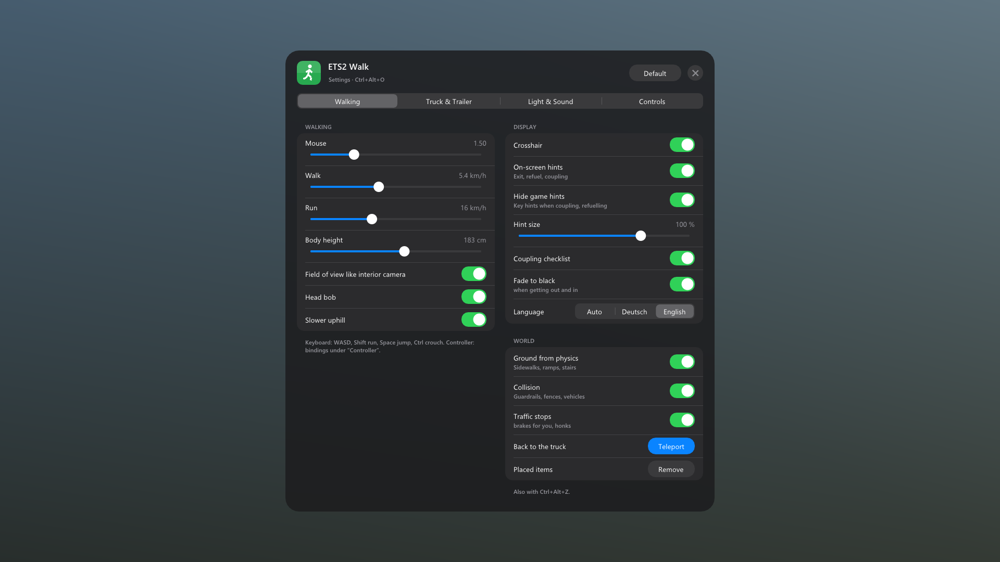

# ETS2 Walk

[Deutsch](README.md) · English

Walk around in Euro Truck Simulator 2. Get out, walk around your truck, couple the trailer by hand, refuel at the pump yourself, set up warning lights, take a break on a bench and go to sleep in the cab at night – all in first person, with its own sounds and an in-game menu.

Fan project, not affiliated with SCS Software. Trademarks belong to their owners.

## Contents

- [Features](#features)
- [Requirements](#requirements)
- [Installation](#installation)
- [Controls](#controls)
- [Settings and data](#settings-and-data)
- [FAQ](#faq)
- [Uninstall](#uninstall)
- [Licenses and thanks](#licenses-and-thanks)

## Features

### Walking

- Get out with the action key once the parking brake is on. The door opens and you're standing next to the truck
- Walk, run, jump, crouch. Slower uphill, subtle head bob, adjustable body height
- The ground comes from the game's physics: sidewalks, ramps, stairs, loading docks. Guardrails, fences and vehicles block you
- Footsteps sound different on asphalt, gravel, grass, metal, snow and wood
- AI traffic brakes for you and honks if you stand on the road too long
- Open and close gates at company yards

### In the truck

- Move to the passenger seat or lie down on the bed in a sleeper cab. The plugin detects whether your truck has a bed
- On the bed: hold the key to sleep (through the game's sleep dialog)
- On the passenger seat and the bed it sounds like inside the cab, not outside

### Coupling by hand

- Uncoupling: disconnect air and electric lines, crank the landing gear down, pull the fifth wheel lever
- Coupling: back under the trailer, check the fifth wheel, connect the lines, crank the landing gear up. Then a tug test
- Optional extra steps: safety catch on the lever, trailer parking brake (red knob), light check
- A checklist shows what's next, with the game's own cranking and line sounds
- Couple again right after uncoupling, without pulling forward and backing up

### Walkaround check

- After coupling, walk around the rig once: tyres, front lights, trailer tyres, cargo and doors, rear lights
- The plugin tells you about wear and how the cargo is doing

### Refuelling

- Get out at the pump, open the fuel flap, hold the key to refuel. You see how much is in the tank
- Stops on its own when the tank is full

### Remote key

- Lock and unlock the truck with indicator flashes and an optional short honk. Engine off when locking
- Hold the key: windows close or open
- Follow-me-home: when it's dark, the lights stay on for a moment after locking
- Lock automatically when you walk away

### Equipment

- The storage box behind the cab holds warning lights and traffic cones. Take them out, set them up, collect them again
- The warning lights blink and really light up at night
- If a vehicle hits them, they tip over. What you set up stays in place after a restart

### Breaks

- Sit down on benches at rest areas and fuel stations. Hold the key to take a break while your truck is in a parking spot

### Also

- Flashlight in your hand or on your head, three beam modes
- Controller support with Xbox or PlayStation icons, buttons can be rebound
- Hints at the bottom of the screen show which key does what. The plugin hides the game's own key hints where it guides you itself
- German and English (follows Windows, can be changed in the menu)
- Nothing in the game is changed: no mods in the game files, no changes to `config.cfg`

## Requirements

- Euro Truck Simulator 2 **1.61** (tested with 1.61.1.9s), Windows 10 or 11, 64-bit
- After a game update, some features may stop working until a new version is out. The plugin checks at startup whether the places it uses still match and only turns off the affected part otherwise

## Installation

1. Download `ETS2-Walk-Setup-<version>.exe` from [Releases](../../releases/latest) and run it
2. Choose **Install**. The setup finds the game through Steam, otherwise you choose the game folder yourself
3. Start the game and confirm the SDK plugin message with **OK**

Without the setup: unpack the ZIP and copy `ets2_walk.dll` to `Euro Truck Simulator 2\bin\win_x64\plugins\` (create the `plugins` folder if needed).

Update: just run the new setup. Your settings are kept. The game has to be closed.

## Controls

| Key | What |
|---|---|
| E | Action: get out, get in, refuel, couple, gates … (hold where shown) |
| W A S D | walk |
| Shift | run |
| Space | jump |
| Ctrl | crouch |
| T | flashlight (hold: change mode) |
| K | remote key: lock/unlock (hold: windows) |
| Ctrl+Alt+O | menu |
| Ctrl+Alt+Z | back to the truck |
| Ctrl+Alt+W | get out/in, wherever you are |

Action, flashlight and remote key can be rebound in the menu under **Controls**. With a controller: left stick walks, right stick looks, bindings in the menu.

## Settings and data

Everything except the DLL lives in `Documents\Euro Truck Simulator 2\ETS2 Walk\`: the settings (`ets2_walk.ini`), the sounds (`sounds\`), the lists of benches, fuel stations and parking spots, and what you've set up. The plugin creates the folder on first start. It takes two of the game's sounds (landing gear crank, window motor) from your game files.

The game log (`Documents\Euro Truck Simulator 2\game.log.txt`) contains every plugin message, prefixed with `[ETS2 Walk]`. It helps when something doesn't work.

## FAQ

**I can't get out.** Stop first and apply the parking brake. You can turn this off in the menu under **Truck**.

**The menu doesn't show up.** Check the game log for `[ETS2 Walk]`. If it isn't there, the DLL isn't in the right folder or the SDK message at startup was declined.

**Does it work with TruckersMP or American Truck Simulator?** No, only Euro Truck Simulator 2 in single player.

**Does it work together with ETS2 CarPlay?** Yes, both plugins run side by side.

## Uninstall

Windows Settings → **Apps** → ETS2 Walk → Uninstall, or run the setup again and choose **Remove**. The game has to be closed. If you like, settings and data are moved to the Recycle Bin.

## Licenses and thanks

- Parts for reading the game's memory come from the [ETS2LA game plugin](https://github.com/ETS2LA/plugin) (MIT license)
- [Dear ImGui](https://github.com/ocornut/imgui) (MIT), [MinHook](https://github.com/TsudaKageyu/minhook) (BSD-2), SCS Telemetry SDK, NVIDIA PhysX 3.4 (headers, BSD-3)
- Reading the game archives follows the map parser of [truckermudgeon/maps](https://github.com/truckermudgeon/maps), CityHash by Google (MIT)
- Sounds: [Kenney](https://kenney.nl) (CC0) and recordings from [Pixabay](https://pixabay.com) (Pixabay license, only redistributed as part of the plugin)
