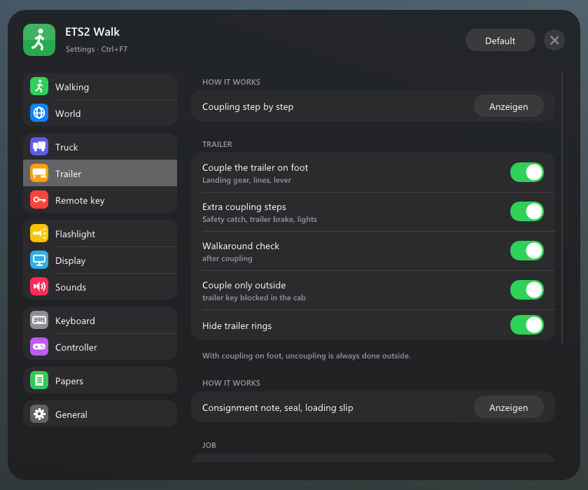
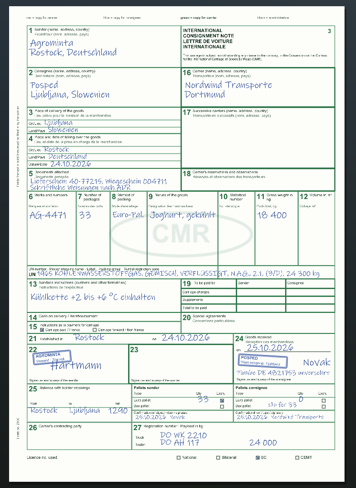
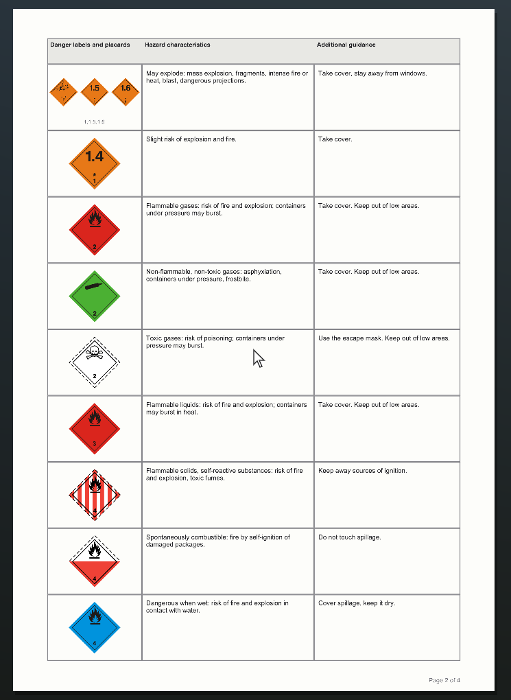
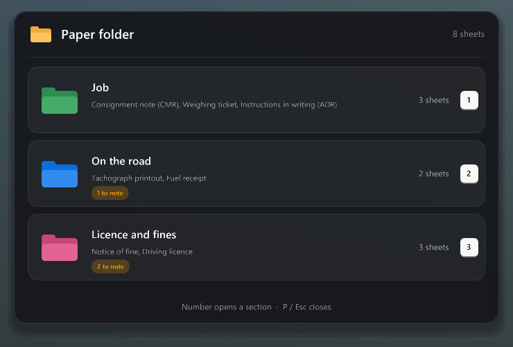
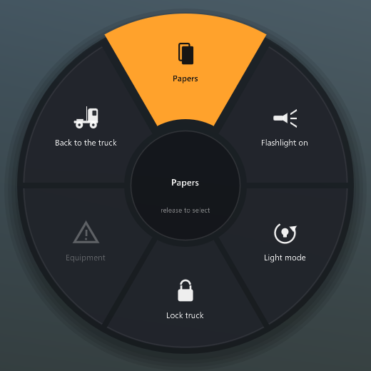
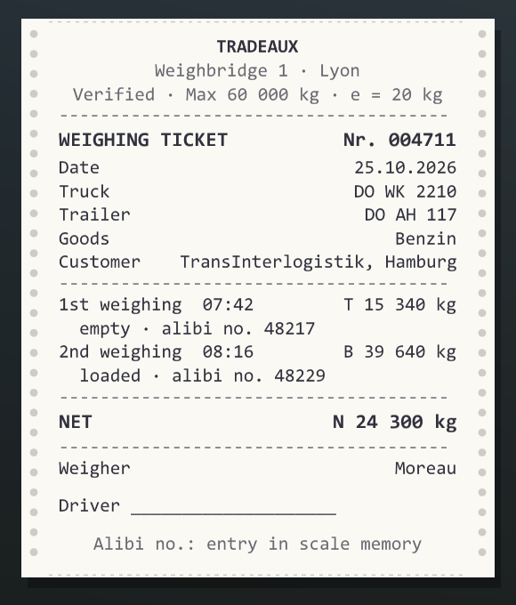
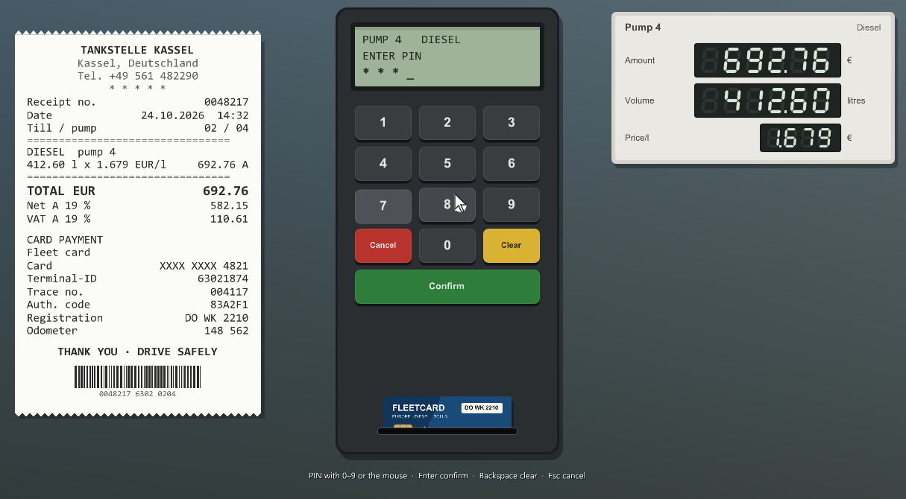

# ETS2 Walk

[Deutsch](README.md) · English

Walk around in Euro Truck Simulator 2. Get out, walk around your truck, couple the trailer by hand, sign the consignment note with the warehouse worker, pay at the pump with your fuel card, set up warning lights, take a break on a bench and go to sleep in the cab at night – all in first person, with its own sounds and an in-game menu.

Fan project, not affiliated with SCS Software. Trademarks belong to their owners.

## Contents

- [Features](#features)
- [Screenshots](#screenshots)
- [Requirements](#requirements)
- [Installation](#installation)
- [Controls](#controls)
- [Settings and data](#settings-and-data)
- [FAQ](#faq)
- [Uninstall](#uninstall)
- [Licenses and thanks](#licenses-and-thanks)

## Features

### Walking

- Get out with the action key once the parking brake is on. The door opens and you're standing next to the truck
- Walk, run, jump, crouch. Slower uphill, subtle head bob, adjustable body height
- The ground comes from the game's physics: sidewalks, ramps, stairs, loading docks. Guardrails, fences and vehicles block you
- Footsteps sound different on asphalt, gravel, grass, metal, snow and wood
- AI traffic brakes for you and honks if you stand on the road too long
- Open and close gates at company yards
- Optional arrows at the top of the screen point to your truck, the trailer and the warehouse worker

### In the truck

- Move to the passenger seat or lie down on the bed in a sleeper cab. The plugin detects whether your truck has a bed
- On the bed: hold the key to sleep (through the game's sleep dialog)
- On the passenger seat and the bed it sounds like inside the cab, not outside
- Driver card and driving time (optional): at the start of a shift you insert the card into the tachograph in the overhead console. Driving and rest time show at the top right, roadside checks look at both

### Coupling by hand

- Uncoupling: disconnect air and electric lines, place the wheel chocks, crank the landing gear down, pull the fifth wheel lever
- Coupling: back under the trailer, check the fifth wheel, connect the lines, crank the landing gear up, remove the chocks. Then a tug test
- Optional extra steps: safety catch on the lever, trailer parking brake (red knob), light check
- A checklist shows what's next, with the game's own cranking and line sounds
- Couple again right after uncoupling, without pulling forward and backing up

### Walkaround check

- After coupling, walk around truck and trailer once: tyres, front lights, trailer tyres, cargo and doors, rear lights, and on reefers the refrigeration unit with its display
- The plugin tells you about wear and how the cargo is doing

### Jobs and paperwork

- With every job a warehouse worker stands next to the trailer and hands you the consignment note. A CMR note like the real one, a carbon set in the real colours, with companies, cities, cargo, weight and registrations from the job
- You sign field 23 yourself with the mouse and press your stamp on it. Set your name and town in the menu under Trailer
- At the destination you hand it to the worker. After unloading you get it back signed, with the consignee's stamp and signature. "Skip parking" counts as handing it over
- Sealed trailers: check the seal at the rear, at the sender and at the destination. Its number is on the consignment note
- Your own trailer: chocks at the dock, wait for loading, tick off load securing on the loading slip and sign it, then the worker seals the trailer
- Pallet exchange: Euro pallets are on the consignment note. With your own trailer the empty ones come along, otherwise you get a pallet slip
- Weighing ticket for tank, silo and bulk cargo, like from a verified weighbridge
- Dangerous goods (ADR): UN number with quantity on the consignment note, and the instructions in writing as the real 4-page form with the real danger labels
- Everything goes into the paper folder (P). The right mouse button is a magnifier
- Roadside checks: no consignment note, no chock and warning signs on board with dangerous goods, or no driver card means a fine
- Menu → Papers keeps the last 20 consignment notes and 30 fuel receipts

### Refuelling

- Just like the real thing: open the fuel cap, walk to the pump, insert the fuel card, type the PIN (set in the menu), optionally the odometer, then refuel at the cap. With a large tank on both sides
- The pump display counts amount and litres, afterwards you get a receipt with the country fuel price, VAT, registration and odometer

### Remote key

- Lock and unlock the truck with indicator flashes and an optional short honk. Engine off when locking
- Hold at the truck: windows close or open
- Hold far away (from 60 m, adjustable): the truck flashes and honks, an arrow at the top of the screen shows where it is
- Follow-me-home: when it's dark, the lights stay on for a moment after locking
- Lock automatically when you walk away

### Equipment

- The storage box behind the cab holds warning lights, traffic cones, a warning triangle, wheel chocks and a camping chair. Take them out, set them up, collect them again
- With the warning triangle you see how far behind the rig you are. Wheel chocks snap in front of or behind a wheel and get pushed away if you drive off with them
- The warning lights blink and really light up at night. If a vehicle hits them, they tip over

### Quick menu and breaks

- Quick menu wheel (hold Tab): papers, flashlight, light mode, lock or unlock the truck, equipment, back to the truck
- Sit down on benches at rest areas and fuel stations. Hold the key to take a break while your truck is in a parking spot

### Also

- Flashlight in your hand or on your head, modes normal, wide, far and custom
- Controller support with Xbox or PlayStation icons, every button can be rebound
- An introduction on first start, any time again under General › Help
- Export and import your settings to share them
- German and English (follows Windows, can be changed in the menu)
- Nothing in the game is changed: no mods in the game files, no changes to `config.cfg`

## Screenshots

| | |
|---|---|
|  |  |
| CMR consignment note, signed, with dangerous goods and pallet exchange | Instructions in writing according to ADR, page 2 |
|  |  |
| Paper folder (P) | Quick menu wheel (hold Tab) |
|  |  |
| Weighing ticket for tank, silo and bulk | Fuel receipt, card terminal and pump |

## Requirements

- Euro Truck Simulator 2 **1.61** (tested with 1.61.1.9s), Windows 10 or 11, 64-bit
- After a game update, some features may stop working until a new version is out. The plugin checks at startup whether the places it uses still match and only turns off the affected part otherwise

## Installation

1. Download `ETS2-Walk-Setup-<version>.exe` from [Releases](../../releases/latest) and run it
2. Choose **Install**. The setup finds the game through Steam, otherwise you choose the game folder yourself
3. Start the game and confirm the SDK plugin message with **OK**

Without the setup: unpack the ZIP and copy `ets2_walk.dll` to `Euro Truck Simulator 2\bin\win_x64\plugins\` (create the `plugins` folder if needed).

Update: just run the new setup. Your settings are kept. The game has to be closed.

## Controls

| Key | Controller | What |
|---|---|---|
| E | X | Action: get out, get in, refuel, couple, papers, gates … (hold where shown) |
| W A S D | left stick | walk |
| Shift | RT | run |
| Space | A | jump |
| Ctrl | B | crouch |
| T | LB | flashlight (hold: change mode) |
| K | RB | remote key: tap to lock/unlock, hold at the truck: windows, hold further away: find the truck |
| P | Y | paper folder; inside, 1–4 (controller: d-pad) opens a sheet |
| Tab (hold) | d-pad up | quick menu |
| right mouse button | LT | zoom, magnifier on papers |
| Ctrl+F7 | – | menu |
| Ctrl+Alt+Z | Back (hold) | back to the truck |

Every key and button can be rebound in the menu under **Keyboard** and **Controller**.

## Settings and data

Sounds and the lists of benches, fuel stations and parking spots are built into the DLL. The plugin reads two of the game's sounds (landing gear crank, window motor) from your game files at startup. `Documents\Euro Truck Simulator 2\ETS2 Walk\` only holds your settings (`ets2_walk.ini`), what you've set up, your papers, and the wheel chock model (`models\`, created by the plugin).

Custom sounds: a file with the same name in `ETS2 Walk\sounds\` replaces the built-in sound (for example `truck_lock.wav`).

The game log (`Documents\Euro Truck Simulator 2\game.log.txt`) contains every plugin message, prefixed with `[ETS2 Walk]`. It helps when something doesn't work.

## FAQ

**I can't get out.** Stop first and apply the parking brake. You can turn this off in the menu under **Truck**.

**The menu doesn't show up.** Check the game log for `[ETS2 Walk]`. If it isn't there, the DLL isn't in the right folder or the SDK message at startup was declined.

**I don't want paperwork.** Consignment note, fuel card, wheel chocks with jobs and the driver card can each be turned off in the menu.

**Does it work with TruckersMP or American Truck Simulator?** No, only Euro Truck Simulator 2 in single player.

**Does it work together with ETS2 CarPlay?** Yes, both plugins run side by side.

## Uninstall

Windows Settings → **Apps** → ETS2 Walk → Uninstall, or run the setup again and choose **Remove**. The game has to be closed. If you like, settings and data are moved to the Recycle Bin.

## Licenses and thanks

- Parts for reading the game's memory come from the [ETS2LA game plugin](https://github.com/ETS2LA/plugin) (MIT license)
- [Dear ImGui](https://github.com/ocornut/imgui) (MIT), [MinHook](https://github.com/TsudaKageyu/minhook) (BSD-2), SCS Telemetry SDK, NVIDIA PhysX 3.4 (headers, BSD-3)
- Reading the game archives follows the map parser of [truckermudgeon/maps](https://github.com/truckermudgeon/maps), CityHash by Google (MIT)
- Danger labels: public domain drawings from [Wikimedia Commons](https://commons.wikimedia.org/wiki/Category:Diagrams_of_ADR_markings)
- Sounds: [Kenney](https://kenney.nl) (CC0) and recordings from [Pixabay](https://pixabay.com) (Pixabay license, only redistributed as part of the plugin)
