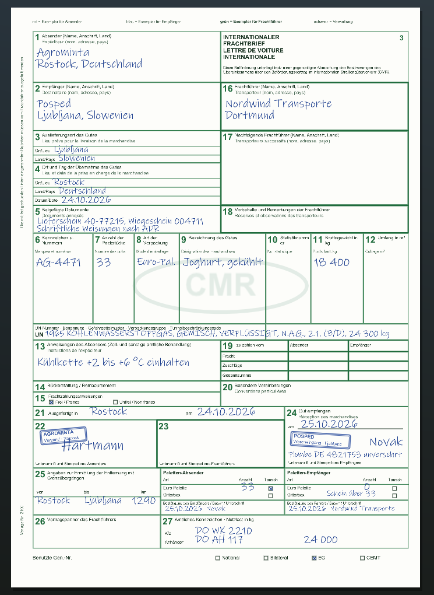
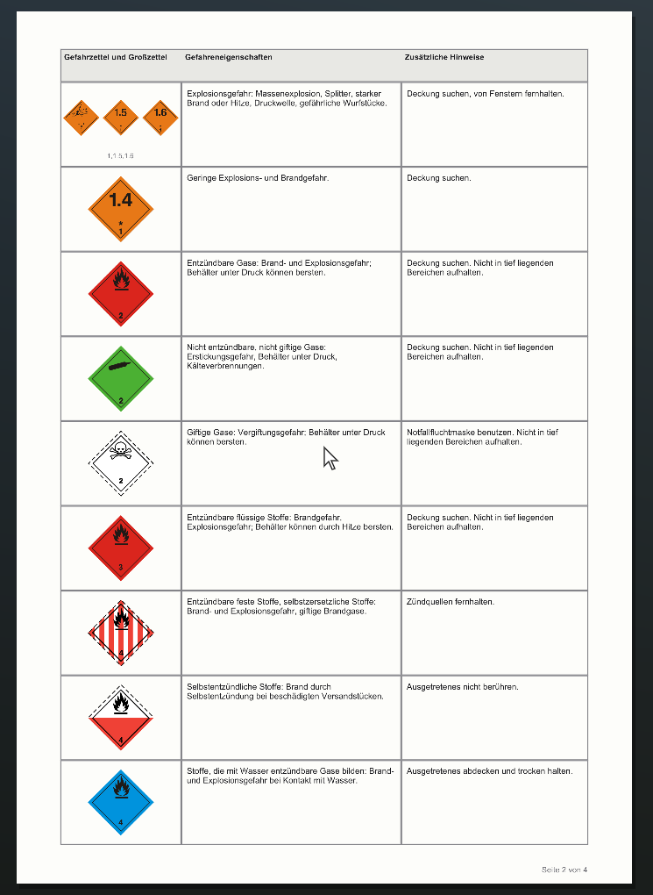
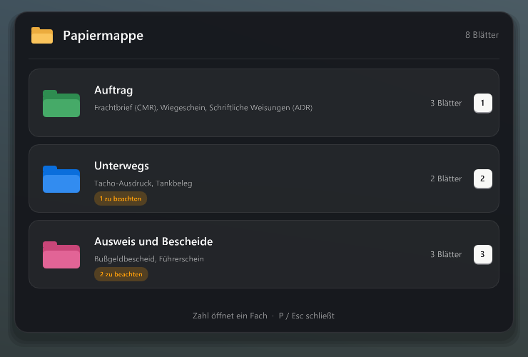
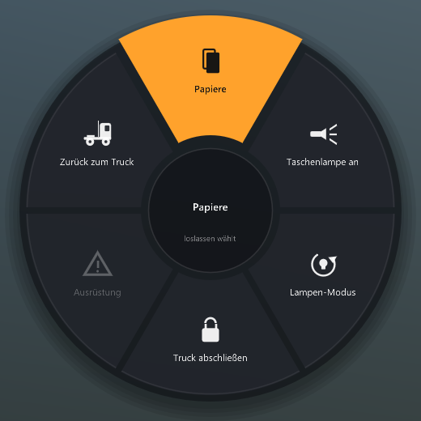
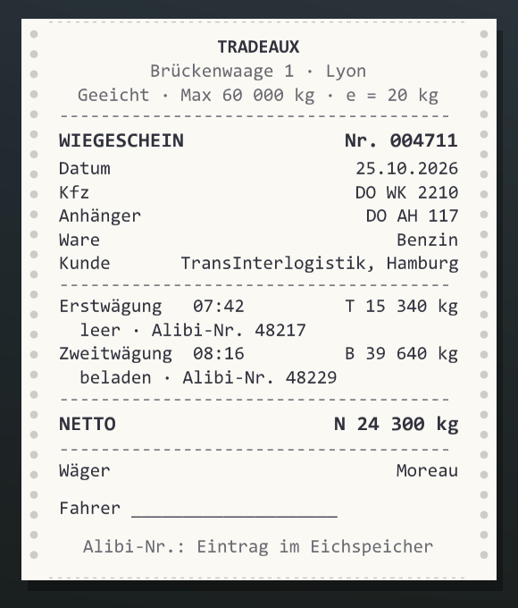
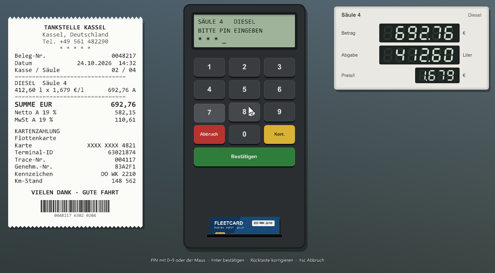

# ETS2 Walk

Deutsch · [English](README.en.md)

Zu Fuß unterwegs in Euro Truck Simulator 2. Aussteigen, um den Truck herumgehen, den Auflieger von Hand ankuppeln, beim Lager-Mitarbeiter den Frachtbrief unterschreiben, an der Zapfsäule mit Tankkarte zahlen, Warnleuchten aufstellen, auf einer Bank Pause machen und abends in der Kabine schlafen gehen – alles aus der Ich-Sicht, mit eigenen Geräuschen und einem Menü im Spiel.

Fan-Projekt, nicht verbunden mit SCS Software. Die Marken gehören ihren Inhabern.

## Inhalt

- [Was es kann](#was-es-kann)
- [Bilder](#bilder)
- [Voraussetzungen](#voraussetzungen)
- [Installieren](#installieren)
- [Bedienung](#bedienung)
- [Einstellungen und Daten](#einstellungen-und-daten)
- [Häufige Fragen](#häufige-fragen)
- [Deinstallieren](#deinstallieren)
- [Lizenzen und Danke](#lizenzen-und-danke)

## Was es kann

### Laufen

- Aussteigen mit der Aktionstaste, wenn die Feststellbremse gezogen ist. Die Tür geht auf, du stehst neben dem Truck
- Gehen, Rennen, Springen, Ducken. Bergauf langsamer, leichtes Kopfwippen, Körpergröße einstellbar
- Der Boden kommt aus der Physik des Spiels: Gehwege, Rampen, Treppen, Laderampen. Leitplanken, Zäune und Fahrzeuge halten dich auf
- Schritte klingen je nach Untergrund (Asphalt, Kies, Gras, Metall, Schnee, Holz)
- Der KI-Verkehr bremst vor dir und hupt, wenn du zu lange auf der Straße stehst
- Tore an Firmengeländen öffnen und schließen
- Pfeile oben im Bild zeigen auf Wunsch, wo Truck, Auflieger und Lager-Mitarbeiter stehen

### Im Truck

- Auf den Beifahrersitz wechseln oder dich in einer Schlafkabine aufs Bett legen. Ob dein Truck ein Bett hat, erkennt das Plugin selbst
- Auf dem Bett: Taste halten zum Schlafen (über den Schlaf-Dialog des Spiels)
- Am Beifahrersitz und auf dem Bett klingt es wie in der Kabine, nicht wie draußen
- Fahrerkarte und Lenkzeit (optional): Zu Schichtbeginn steckst du die Karte in den Fahrtenschreiber oben in der Dachkonsole. Oben rechts siehst du Lenk- und Ruhezeit, Kontrollen prüfen beides

### Auflieger von Hand kuppeln

- Abkoppeln: Luft- und Stromleitungen lösen, Unterlegkeile anlegen, Stützen runterkurbeln, Königszapfen-Hebel ziehen
- Ankoppeln: unterfahren, Sattelkupplung prüfen, Leitungen anschließen, Stützen hochkurbeln, Keile entfernen. Danach Schlepptest
- Optional mehr Schritte: Sicherung am Kupplungshebel, Anhänger-Feststellbremse (roter Knopf), Beleuchtung prüfen
- Eine Checkliste zeigt, was als Nächstes dran ist. Mit den Kurbel- und Leitungsgeräuschen des Spiels
- Nach dem Abkoppeln gleich wieder ankoppeln, ohne vor- und zurückzusetzen

### Abfahrtskontrolle

- Nach dem Ankuppeln einmal um Truck und Auflieger gehen: Reifen, Licht vorne, Anhänger-Reifen, Ladung und Türen, Rückleuchten, beim Kühlauflieger das Kühlgerät mit Anzeige
- Das Plugin sagt dir, wie es um Verschleiß und Ladung steht

### Aufträge und Papiere

- Bei jedem Auftrag steht ein Lager-Mitarbeiter neben dem Auflieger und gibt dir den Frachtbrief. Ein CMR-Frachtbrief wie der echte, im Durchschreibesatz mit den echten Farben, mit Firmen, Städten, Ladung, Gewicht und Kennzeichen aus dem Auftrag
- Du unterschreibst Feld 23 selbst mit der Maus und drückst deinen Stempel drauf. Name und Ort stellst du im Menü unter Anhänger ein
- Am Ziel gibst du ihn beim Mitarbeiter ab. Nach dem Entladen bekommst du ihn quittiert zurück, mit Stempel und Unterschrift des Empfängers. „Parken überspringen“ zählt wie die Übergabe
- Verplombte Auflieger: Plombe am Heck prüfen, beim Absender und am Ziel. Die Nummer steht auf dem Frachtbrief
- Eigener Auflieger: Keile an der Rampe, Beladung abwarten, Verladeschein mit Ladungssicherung abhaken und unterschreiben, dann verplombt der Mitarbeiter
- Palettentausch: Euro-Paletten stehen auf dem Frachtbrief. Am eigenen Auflieger kommen die leeren gleich mit, sonst gibt es einen Palettenschein
- Wiegeschein bei Tank, Silo und Schüttgut, wie von einer geeichten Fahrzeugwaage
- Gefahrgut (ADR): UN-Nummer mit Menge auf dem Frachtbrief und die Schriftlichen Weisungen als echter 4-Seiten-Vordruck mit den echten Gefahrzetteln
- Alles steckt in der Papiermappe (P). Rechte Maustaste ist die Lupe
- Straßenkontrollen: Ohne Frachtbrief, bei Gefahrgut ohne Keil und Warnzeichen an Bord oder ohne Fahrerkarte gibt es ein Bußgeld
- Im Menü unter Papiere liegen die letzten 20 Frachtbriefe und 30 Tankbelege

### Tanken

- Ablauf wie in echt: Tankdeckel öffnen, zur Säule, Tankkarte rein, PIN eintippen (im Menü einstellbar), auf Wunsch Kilometerstand, dann am Deckel tanken. Bei großem Tank geht es auf beiden Seiten
- Die Anzeige der Säule zählt Betrag und Liter mit, danach gibt es einen Beleg mit Literpreis des Landes, Mehrwertsteuer, Kennzeichen und Kilometerstand

### Funkschlüssel

- Truck ab- und aufschließen, mit Blinkern und auf Wunsch kurzem Hupen. Motor aus beim Abschließen
- Am Truck halten: Fenster zu oder auf
- Weit weg halten (ab 60 m, einstellbar): Der Truck blinkt und hupt, ein Pfeil oben im Bild zeigt, wo er steht
- Follow-me-home: Wenn es dunkel ist, bleibt das Licht nach dem Abschließen noch kurz an
- Automatisch abschließen, wenn du dich entfernst

### Ausrüstung

- Im Staukasten hinter der Kabine liegen Warnleuchten, Pylonen, ein Warndreieck, Unterlegkeile und ein Campingstuhl. Rausnehmen, aufstellen, wieder einsammeln
- Beim Warndreieck siehst du, wie weit du schon hinter dem Zug bist. Unterlegkeile rasten vor oder hinter einem Rad ein und werden weggeschoben, wenn du damit losfährst
- Die Warnleuchten blinken und leuchten nachts wirklich. Fährt ein Fahrzeug dagegen, kippen sie um

### Schnellwahl und Pause

- Schnellwahl-Rad (Tab halten): Papiere, Taschenlampe, Lampen-Modus, Truck ab- und aufschließen, Ausrüstung, zurück zum Truck
- Auf Bänken an Rastplätzen und Tankstellen hinsetzen. Taste halten, um Pause zu machen, wenn dein Truck auf einem Parkplatz steht

### Sonst noch

- Taschenlampe in der Hand oder am Kopf, Modi Normal, Breit, Weit und Eigen
- Controller-Unterstützung mit Xbox- oder PlayStation-Symbolen, alle Knöpfe frei belegbar
- Eine Einführung beim ersten Start, jederzeit wieder unter Allgemein › Hilfe
- Einstellungen exportieren und importieren, zum Weitergeben an andere
- Deutsch und Englisch (richtet sich nach Windows, im Menü umstellbar)
- Am Spiel wird nichts verändert: keine Mods in den Spieldateien, keine Änderung an der `config.cfg`

## Bilder

| | |
|---|---|
|  |  |
| CMR-Frachtbrief, quittiert, mit Gefahrgut und Palettentausch | Schriftliche Weisungen nach ADR, Seite 2 |
|  |  |
| Papiermappe (P) | Schnellwahl-Rad (Tab halten) |
|  |  |
| Wiegeschein bei Tank, Silo und Schüttgut | Tankbeleg, Kartenterminal und Zapfsäule |

## Voraussetzungen

- Euro Truck Simulator 2 **1.61** (getestet mit 1.61.1.9s), Windows 10 oder 11, 64 Bit
- Nach einem Spiel-Update kann es sein, dass einzelne Funktionen ausfallen, bis eine neue Version erscheint. Das Plugin prüft beim Start, ob die Stellen im Spiel noch passen, und schaltet sonst nur den betroffenen Teil ab

## Installieren

1. Unter [Releases](../../releases/latest) `ETS2-Walk-Setup-<Version>.exe` laden und starten
2. **Installieren** wählen. Das Setup findet das Spiel über Steam, sonst wählst du den Spielordner selbst
3. Spiel starten und die Meldung zu SDK-Plugins mit **OK** bestätigen

Ohne Setup: die ZIP entpacken und `ets2_walk.dll` nach `Euro Truck Simulator 2\bin\win_x64\plugins\` kopieren (Ordner `plugins` notfalls anlegen).

Update: einfach das neue Setup starten. Einstellungen bleiben erhalten. Das Spiel muss dabei geschlossen sein.

## Bedienung

| Taste | Controller | Was |
|---|---|---|
| E | X | Aktion: aussteigen, einsteigen, tanken, kuppeln, Papiere, Tore … (halten, wo angezeigt) |
| W A S D | linker Stick | laufen |
| Shift | RT | rennen |
| Leertaste | A | springen |
| Strg | B | ducken |
| T | LB | Taschenlampe (halten: Modus wechseln) |
| K | RB | Funkschlüssel: kurz ab-/aufschließen, am Truck halten: Fenster, weiter weg halten: Truck finden |
| P | Y | Papiermappe; darin öffnen 1–4 (Controller: Steuerkreuz) ein Blatt |
| Tab (halten) | Steuerkreuz hoch | Schnellwahl |
| rechte Maustaste | LT | Zoom, auf Papieren die Lupe |
| Strg+F7 | – | Menü |
| Strg+Alt+Z | Back (halten) | zurück zum Truck |

Alle Tasten und Knöpfe lassen sich im Menü unter **Tastatur** bzw. **Controller** umlegen.

## Einstellungen und Daten

Töne und die Listen mit Bänken, Tankstellen und Parkplätzen stecken in der DLL. Zwei Klänge des Spiels (Stützen kurbeln, Fensterheber) liest das Plugin beim Start aus deinen Spieldateien. In `Dokumente\Euro Truck Simulator 2\ETS2 Walk\` liegen nur deine Einstellungen (`ets2_walk.ini`), was du aufgestellt hast, deine Papiere und das Modell der Unterlegkeile (`models\`, legt das Plugin selbst an).

Eigene Töne: Eine Datei mit demselben Namen in `ETS2 Walk\sounds\` ersetzt den eingebauten Ton (zum Beispiel `truck_lock.wav`).

Im Spiel-Log (`Dokumente\Euro Truck Simulator 2\game.log.txt`) stehen alle Meldungen des Plugins mit `[ETS2 Walk]` davor. Bei Problemen hilft diese Datei weiter.

## Häufige Fragen

**Ich kann nicht aussteigen.** Erst anhalten und die Feststellbremse ziehen. Das lässt sich im Menü unter **Truck** abschalten.

**Das Menü erscheint nicht.** Prüfe im Spiel-Log, ob `[ETS2 Walk]` auftaucht. Wenn nicht, liegt die DLL nicht im richtigen Ordner oder die SDK-Meldung beim Start wurde abgelehnt.

**Ich will keinen Papierkram.** Frachtbrief, Tankkarte, Unterlegkeile bei Aufträgen und die Fahrerkarte lassen sich im Menü einzeln abschalten.

**Funktioniert es mit TruckersMP oder American Truck Simulator?** Nein, nur mit Euro Truck Simulator 2 im Einzelspieler.

**Verträgt es sich mit ETS2 CarPlay?** Ja, beide Plugins laufen zusammen.

## Deinstallieren

Windows-Einstellungen → **Apps** → ETS2 Walk → Deinstallieren, oder das Setup erneut starten und **Entfernen** wählen. Das Spiel muss geschlossen sein. Auf Wunsch kommen Einstellungen und Daten in den Papierkorb.

## Lizenzen und Danke

- Teile zum Lesen des Spielspeichers stammen aus dem [ETS2LA-Spielplugin](https://github.com/ETS2LA/plugin) (MIT-Lizenz)
- [Dear ImGui](https://github.com/ocornut/imgui) (MIT), [MinHook](https://github.com/TsudaKageyu/minhook) (BSD-2), SCS Telemetry SDK, NVIDIA PhysX 3.4 (Header, BSD-3)
- Lesen der Spielarchive nach dem Kartenparser von [truckermudgeon/maps](https://github.com/truckermudgeon/maps), CityHash von Google (MIT)
- Gefahrzettel: gemeinfreie Zeichnungen von [Wikimedia Commons](https://commons.wikimedia.org/wiki/Category:Diagrams_of_ADR_markings)
- Geräusche: [Kenney](https://kenney.nl) (CC0) und Aufnahmen von [Pixabay](https://pixabay.com) (Pixabay-Lizenz, nur zusammen mit dem Plugin weitergeben)
