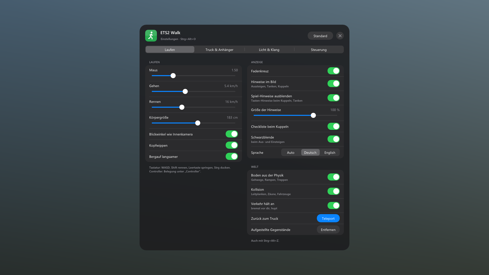

# ETS2 Walk

Deutsch · [English](README.en.md)

Zu Fuß unterwegs in Euro Truck Simulator 2. Aussteigen, um den Truck herumgehen, den Auflieger von Hand ankuppeln, an der Zapfsäule selbst tanken, Warnleuchten aufstellen, auf einer Bank Pause machen und abends in der Kabine schlafen gehen – alles aus der Ich-Sicht, mit eigenen Geräuschen und einem Menü im Spiel.

Fan-Projekt, nicht verbunden mit SCS Software. Die Marken gehören ihren Inhabern.

## Inhalt

- [Was es kann](#was-es-kann)
- [Voraussetzungen](#voraussetzungen)
- [Installieren](#installieren)
- [Bedienung](#bedienung)
- [Einstellungen und Daten](#einstellungen-und-daten)
- [Häufige Fragen](#häufige-fragen)
- [Deinstallieren](#deinstallieren)
- [Lizenzen und Danke](#lizenzen-und-danke)

## Was es kann

### Laufen

- Aussteigen mit der Aktionstaste, wenn die Feststellbremse gezogen ist. Die Tür geht auf, du stehst neben dem Truck
- Gehen, Rennen, Springen, Ducken. Bergauf langsamer, leichtes Kopfwippen, Körpergröße einstellbar
- Der Boden kommt aus der Physik des Spiels: Gehwege, Rampen, Treppen, Laderampen. Leitplanken, Zäune und Fahrzeuge halten dich auf
- Schritte klingen je nach Untergrund (Asphalt, Kies, Gras, Metall, Schnee, Holz)
- Der KI-Verkehr bremst vor dir und hupt, wenn du zu lange auf der Straße stehst
- Tore an Firmengeländen öffnen und schließen

### Im Truck

- Auf den Beifahrersitz wechseln oder dich in einer Schlafkabine aufs Bett legen. Ob dein Truck ein Bett hat, erkennt das Plugin selbst
- Auf dem Bett: Taste halten zum Schlafen (über den Schlaf-Dialog des Spiels)
- Am Beifahrersitz und auf dem Bett klingt es wie in der Kabine, nicht wie draußen

### Auflieger von Hand kuppeln

- Abkoppeln: Luft- und Stromleitungen lösen, Stützen runterkurbeln, Königszapfen-Hebel ziehen
- Ankoppeln: unterfahren, Sattelkupplung prüfen, Leitungen anschließen, Stützen hochkurbeln. Danach Schlepptest
- Optional mehr Schritte: Sicherung am Kupplungshebel, Anhänger-Feststellbremse (roter Knopf), Beleuchtung prüfen
- Eine Checkliste zeigt, was als Nächstes dran ist. Mit den Kurbel- und Leitungsgeräuschen des Spiels
- Nach dem Abkoppeln gleich wieder ankoppeln, ohne vor- und zurückzusetzen

### Abfahrtskontrolle

- Nach dem Ankuppeln einmal um den Zug gehen: Reifen, Licht vorne, Anhänger-Reifen, Ladung und Türen, Rückleuchten
- Das Plugin sagt dir, wie es um Verschleiß und Ladung steht

### Tanken

- An der Zapfsäule aussteigen, Tankklappe auf, Taste halten zum Tanken. Die Anzeige zeigt, wie viel schon drin ist
- Hört von selbst auf, wenn der Tank voll ist

### Funkschlüssel

- Truck ab- und aufschließen, mit Blinkern und auf Wunsch kurzem Hupen. Motor aus beim Abschließen
- Taste halten: Fenster zu oder auf
- Follow-me-home: Wenn es dunkel ist, bleibt das Licht nach dem Abschließen noch kurz an
- Automatisch abschließen, wenn du dich entfernst

### Ausrüstung

- Im Staukasten hinter der Kabine liegen Warnleuchten und Pylonen. Rausnehmen, aufstellen, wieder einsammeln
- Die Warnleuchten blinken und leuchten nachts wirklich
- Fährt ein Fahrzeug dagegen, kippen sie um. Was du aufgestellt hast, bleibt auch nach einem Neustart stehen

### Pause

- Auf Bänken an Rastplätzen und Tankstellen hinsetzen. Taste halten, um Pause zu machen, wenn dein Truck auf einem Parkplatz steht

### Sonst noch

- Taschenlampe in der Hand oder am Kopf, drei Leuchtmodi
- Controller-Unterstützung mit Xbox- oder PlayStation-Symbolen, Knöpfe frei belegbar
- Hinweise unten im Bild zeigen, welche Taste was macht. Die Tasten-Hinweise des Spiels blendet das Plugin aus, wo es selbst führt
- Deutsch und Englisch (richtet sich nach Windows, im Menü umstellbar)
- Am Spiel wird nichts verändert: keine Mods in den Spieldateien, keine Änderung an der `config.cfg`

## Voraussetzungen

- Euro Truck Simulator 2 **1.61** (getestet mit 1.61.1.9s), Windows 10 oder 11, 64 Bit
- Nach einem Spiel-Update kann es sein, dass einzelne Funktionen ausfallen, bis eine neue Version erscheint. Das Plugin prüft beim Start, ob die Stellen im Spiel noch passen, und schaltet sonst nur den betroffenen Teil ab

## Installieren

1. Unter [Releases](../../releases/latest) `ETS2-Walk-Setup-<Version>.exe` laden und starten
2. **Installieren** wählen. Das Setup findet das Spiel über Steam, sonst wählst du den Spielordner selbst
3. Spiel starten und die Meldung zu SDK-Plugins mit **OK** bestätigen

Ohne Setup: die ZIP entpacken und `ets2_walk.dll` nach `Euro Truck Simulator 2\bin\win_x64\plugins\` kopieren (Ordner `plugins` notfalls anlegen).

Update: einfach das neue Setup starten. Einstellungen bleiben erhalten. Das Spiel muss dabei geschlossen sein.

## Bedienung

| Taste | Was |
|---|---|
| E | Aktion: aussteigen, einsteigen, tanken, kuppeln, Tore … (halten, wo angezeigt) |
| W A S D | laufen |
| Shift | rennen |
| Leertaste | springen |
| Strg | ducken |
| T | Taschenlampe (halten: Modus wechseln) |
| K | Funkschlüssel: ab-/aufschließen (halten: Fenster) |
| Strg+Alt+O | Menü |
| Strg+Alt+Z | zurück zum Truck |
| Strg+Alt+W | aus-/einsteigen, egal wo du gerade stehst |

Aktion, Taschenlampe und Funkschlüssel lassen sich im Menü unter **Steuerung** umlegen. Mit Controller: linker Stick laufen, rechter Stick schauen, Belegung im Menü.

## Einstellungen und Daten

Alles außer der DLL liegt in `Dokumente\Euro Truck Simulator 2\ETS2 Walk\`: die Einstellungen (`ets2_walk.ini`), die Töne (`sounds\`), die Listen mit Bänken, Tankstellen und Parkplätzen und was du aufgestellt hast. Das Plugin legt den Ordner beim ersten Start selbst an. Zwei Klänge des Spiels (Stützen kurbeln, Fensterheber) holt es dabei aus deinen Spieldateien.

Im Spiel-Log (`Dokumente\Euro Truck Simulator 2\game.log.txt`) stehen alle Meldungen des Plugins mit `[ETS2 Walk]` davor. Bei Problemen hilft diese Datei weiter.

## Häufige Fragen

**Ich kann nicht aussteigen.** Erst anhalten und die Feststellbremse ziehen. Das lässt sich im Menü unter **Truck** abschalten.

**Das Menü erscheint nicht.** Prüfe im Spiel-Log, ob `[ETS2 Walk]` auftaucht. Wenn nicht, liegt die DLL nicht im richtigen Ordner oder die SDK-Meldung beim Start wurde abgelehnt.

**Funktioniert es mit TruckersMP oder American Truck Simulator?** Nein, nur mit Euro Truck Simulator 2 im Einzelspieler.

**Verträgt es sich mit ETS2 CarPlay?** Ja, beide Plugins laufen zusammen.

## Deinstallieren

Windows-Einstellungen → **Apps** → ETS2 Walk → Deinstallieren, oder das Setup erneut starten und **Entfernen** wählen. Das Spiel muss geschlossen sein. Auf Wunsch kommen Einstellungen und Daten in den Papierkorb.

## Lizenzen und Danke

- Teile zum Lesen des Spielspeichers stammen aus dem [ETS2LA-Spielplugin](https://github.com/ETS2LA/plugin) (MIT-Lizenz)
- [Dear ImGui](https://github.com/ocornut/imgui) (MIT), [MinHook](https://github.com/TsudaKageyu/minhook) (BSD-2), SCS Telemetry SDK, NVIDIA PhysX 3.4 (Header, BSD-3)
- Lesen der Spielarchive nach dem Kartenparser von [truckermudgeon/maps](https://github.com/truckermudgeon/maps), CityHash von Google (MIT)
- Geräusche: [Kenney](https://kenney.nl) (CC0) und Aufnahmen von [Pixabay](https://pixabay.com) (Pixabay-Lizenz, nur zusammen mit dem Plugin weitergeben)
